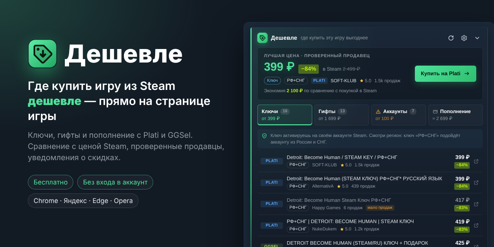
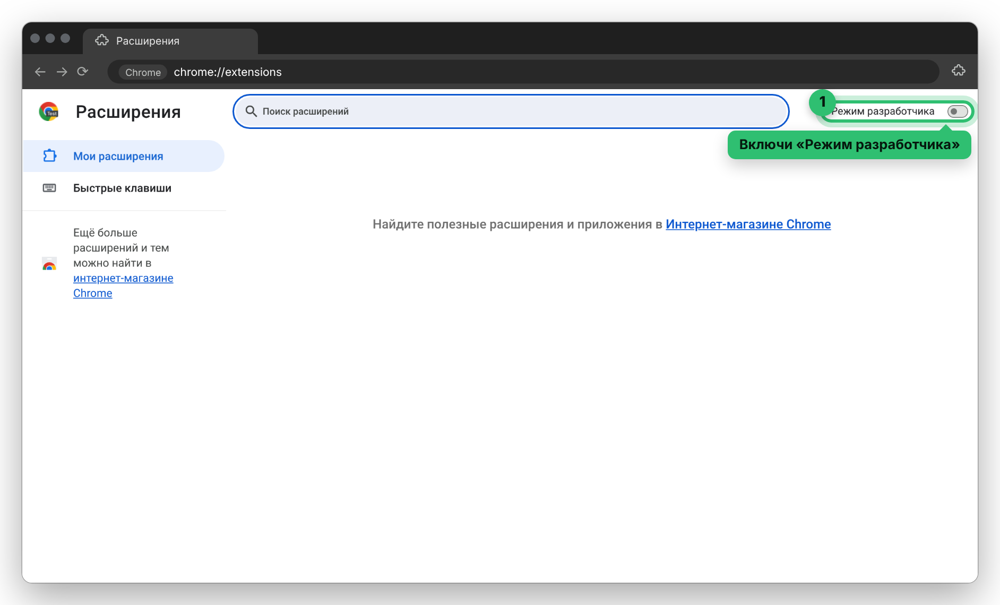
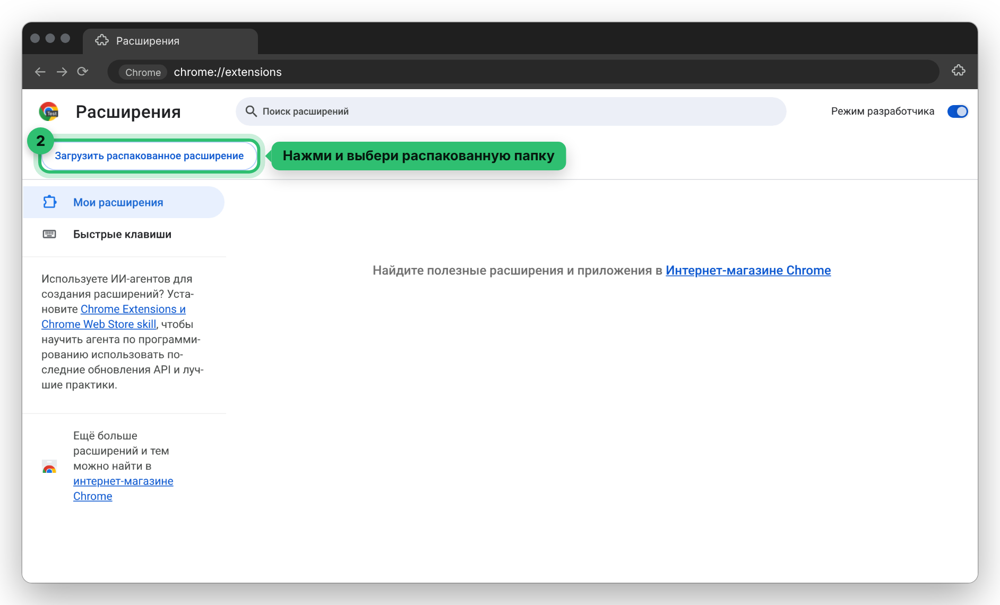
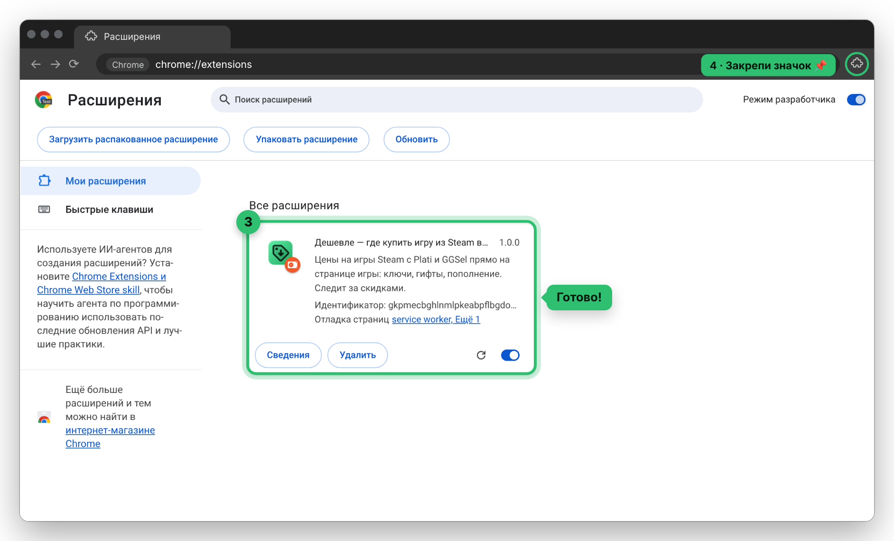
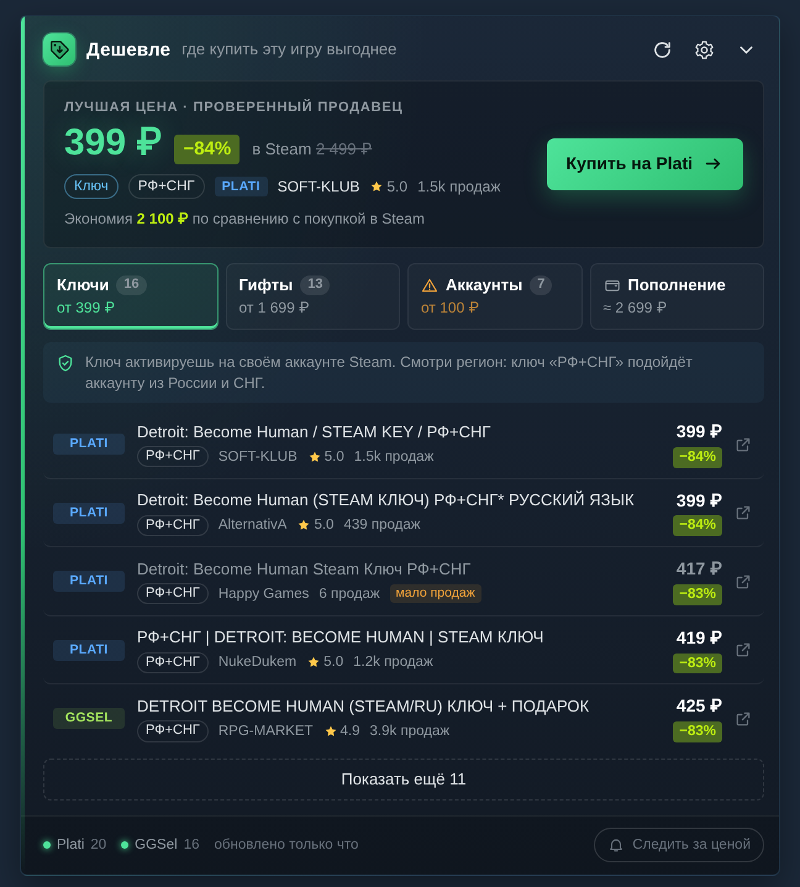
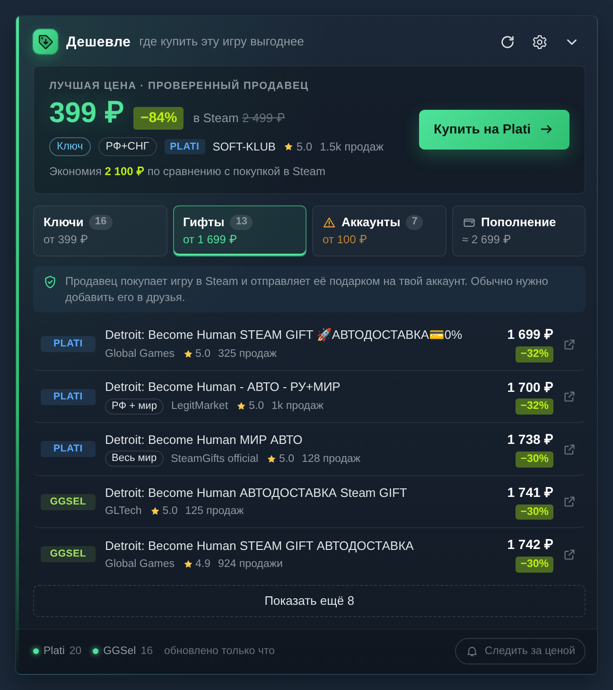
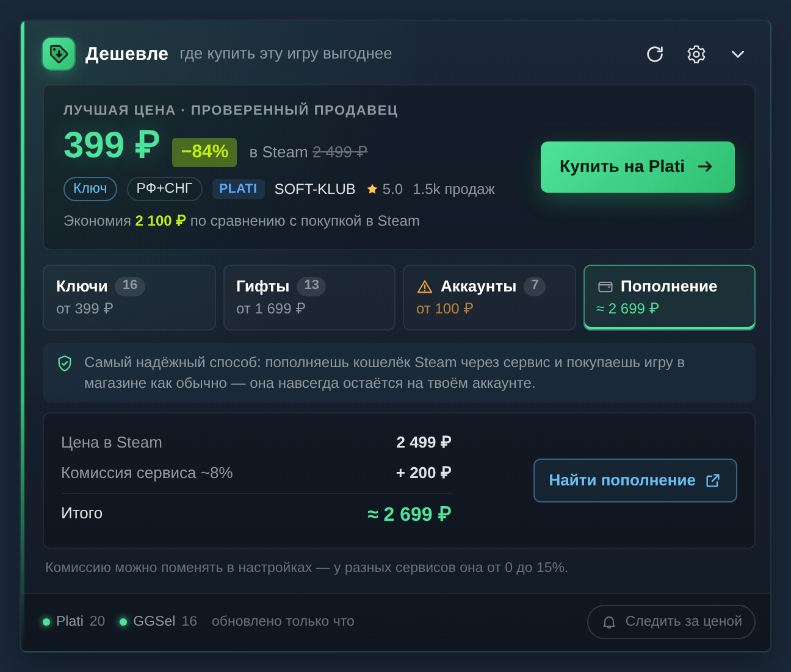
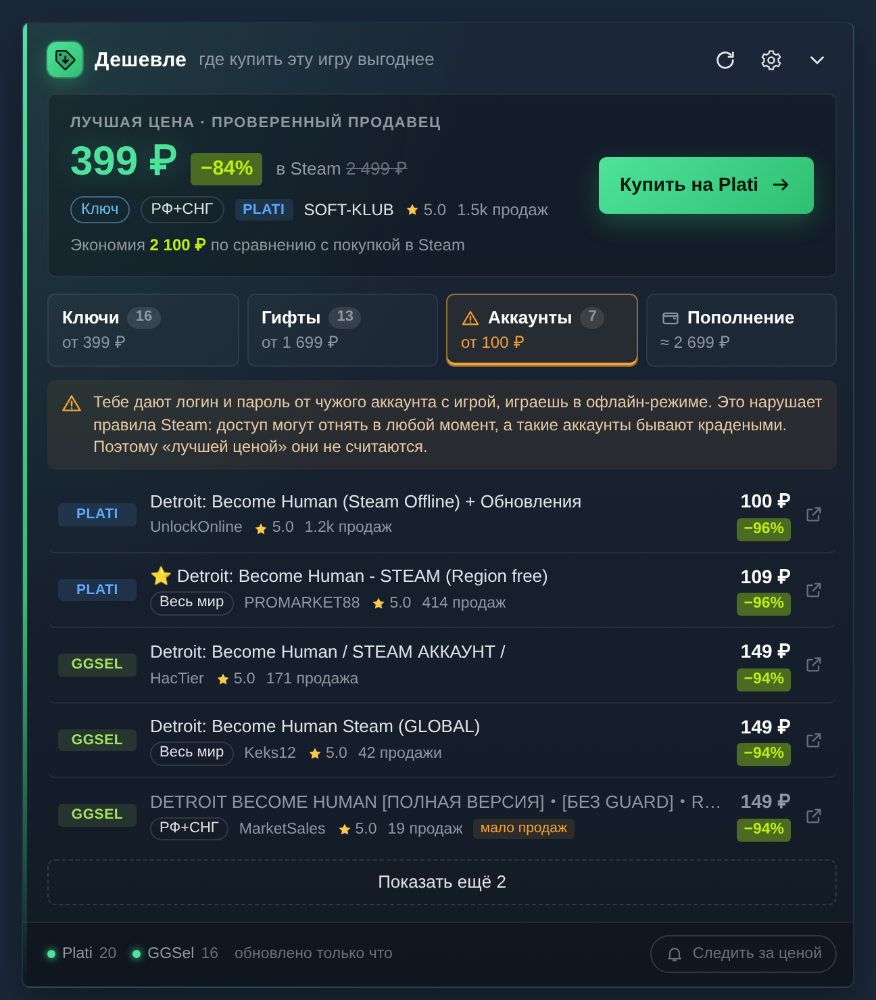
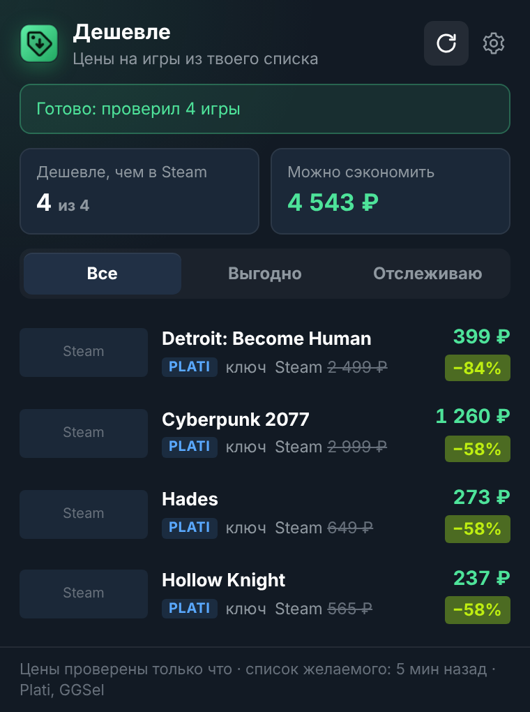
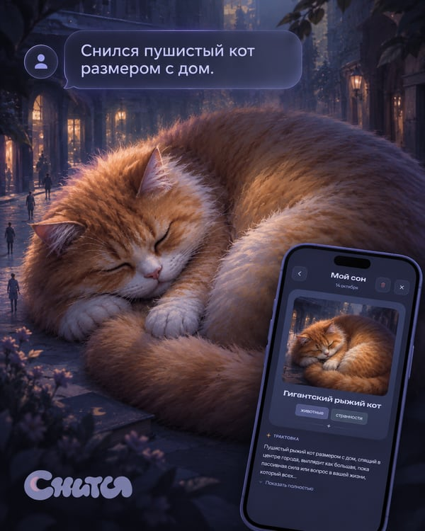

# Дешевле

**Расширение для браузера: прямо на странице игры в Steam показывает, где её можно купить дешевле.**

⏱ Установка — около минуты &nbsp;·&nbsp; 🔒 Входить в аккаунт не нужно &nbsp;·&nbsp; Chrome, Яндекс, Edge, Opera

---

## Установка за минуту

### 1. Скачай архив и распакуй

[**⬇ Скачать deshevle.zip**](https://github.com/Okbitsnok/steam-deshevle/releases/latest/download/deshevle.zip), затем нажми на него правой кнопкой → **«Извлечь всё…»**.

> ⚠️ Папку после установки **не удаляй** — браузер берёт расширение прямо из неё. Положи её туда, где она не помешает, например в «Документы».

### 2. Открой страницу расширений и включи «Режим разработчика»

Вставь в адресную строку `chrome://extensions` и нажми Enter.
В Яндекс Браузере — `browser://extensions`, в Edge — `edge://extensions`, в Opera — `opera://extensions`.

### 3. Нажми «Загрузить распакованное расширение» и выбери папку

Выбери папку, которую распаковал на шаге 1.

### 4. Готово 🎉

В списке появится «Дешевле». Нажми на значок пазла 🧩 справа от адресной строки и закрепи его 📌, чтобы иконка была под рукой.

Теперь открой любую игру в Steam, например [Detroit: Become Human](https://store.steampowered.com/app/1222140/): над кнопкой покупки появится панель с ценами.

<b>Что-то пошло не так?</b>

- **«Не удалось загрузить манифест» / «Manifest file is missing».** Выбрана не та папка. Нужна папка, внутри которой сразу лежит файл `manifest.json`. Если при распаковке получилась папка в папке, выбери внутреннюю.
- **Панель не появилась.** Обнови страницу игры (F5) и проверь, что «Дешевле» включено на странице расширений. Для бесплатных игр панели нет.
- **Как обновить расширение.** Скачай новый архив, распакуй его в ту же папку с заменой файлов и нажми ↻ у «Дешевле» на странице расширений.

## Что умеет

- **Лучшая цена прямо в Steam.** Сколько стоит игра на Plati и GGSel, на сколько это дешевле Steam и сколько ты сэкономишь.
- **Ключи, гифты, аккаунты и пополнение** — на отдельных вкладках, с регионом, рейтингом и числом продаж у продавца.
- **Только проверенные продавцы** в «лучшей цене». Предложения для PlayStation, аренду, DLC и похожие игры расширение отсеивает.
- **Следит за скидками.** Нажми «Следить за ценой», и придёт уведомление, когда игра подешевеет.

<b>Больше скриншотов</b>

<table>
  <tr>
    <td width="50%"> <b>Гифты</b>: продавец дарит игру на твой аккаунт</td>
    <td width="50%"> <b>Пополнение</b>: сколько выйдет купить в самом Steam</td>
  </tr>
  <tr>
    <td width="50%"> <b>Аккаунты</b>: самые дешёвые, но с честным предупреждением о рисках</td>
    <td width="50%" align="center"> <b>Окно расширения</b>: все отслеживаемые игры и выгода</td>
  </tr>
</table>

## Безопасность

- **Входить в Steam не нужно.** Если ты уже вошёл, расширение берёт только номера игр из списка желаемого. Пароль, почту и платёжные данные оно не читает.
- **Своего сервера нет.** Всё хранится только в твоём браузере.
- **Код открыт.** Всё, что делает расширение, лежит в папке [`src`](src) — можно проверить самому или попросить любой ИИ.

Подробнее — в [политике конфиденциальности](PRIVACY.md).

## Частые вопросы

<b>Почему «режим разработчика»? Это безопасно?</b>

Так браузер ставит любые расширения не из магазина. Сам режим ни к чему не даёт доступ — он только разрешает загрузить расширение из папки.

<b>Чем отличаются ключ, гифт и аккаунт?</b>

- **Ключ** — код, который вводишь в Steam («Игры» → «Активировать в Steam»). Игра навсегда на твоём аккаунте. Смотри регион ключа.
- **Гифт** — продавец покупает игру в Steam и дарит её тебе. Тоже навсегда, но обычно дороже ключа.
- **Аккаунт** — логин и пароль от чужого аккаунта с игрой. Самый дешёвый вариант, но нарушает правила Steam: доступ могут отнять. Поэтому «лучшей ценой» он не бывает, а вкладку можно отключить в настройках.

<b>Будет в магазине Chrome? А в Firefox?</b>

Да, публикация в магазинах и версия для Firefox — в планах.

## ❤️ Поддержать проект

«Дешевле» бесплатное и таким останется. Если оно сэкономило тебе денег, вот как можно сказать спасибо:

- ⭐ **Поставь звезду** этому репозиторию — так расширение увидит больше людей.
- 📣 **Расскажи друзьям**, которые покупают игры в Steam.
- 🌙 **Попробуй моё приложение «Снится».**

<table>
  <tr>
    <td width="42%"></td>
    <td>
      <b>«Снится»</b> — приложение в Telegram, которое рисует твои сны.  
      Описываешь сон текстом или голосом — и получаешь арт-иллюстрацию и короткую трактовку того, что он может значить. Ничего скачивать не нужно, а одна генерация в день — бесплатно.  
      Если понравится, можно разово оплатить «Безлимит». Это лучшая поддержка автора 💜  
      <a href="https://t.me/snitsya_app_bot"><b>→ Открыть «Снится» в Telegram</b></a>
    </td>
  </tr>
</table>

## Для разработчиков

Как устроено расширение, как запустить тесты и собрать архив — в [docs/DEVELOPMENT.md](docs/DEVELOPMENT.md).

## Лицензия

[MIT](LICENSE) — код открыт, можно смотреть, использовать и дорабатывать.

Расширение не связано с Valve, Plati или GGSel. Цены берутся из открытых данных площадок.
