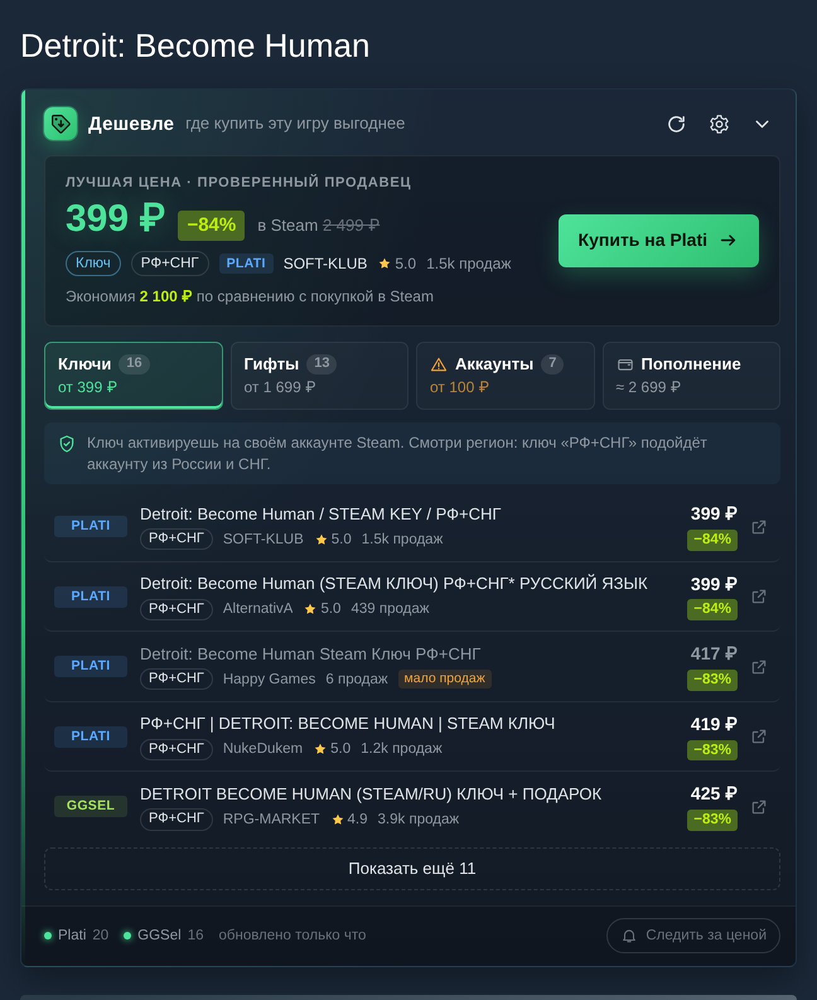

# Дешевле — где купить игру из Steam выгоднее

Расширение для Chrome (и других браузеров на Chromium: Яндекс, Edge, Opera, Brave).

- На странице любой игры в магазине Steam над кнопкой «В корзину» появляется панель:
  **лучшая цена**, скидка в процентах и экономия по сравнению со Steam.
- Предложения разложены по вкладкам: **Ключи**, **Гифты**, **Аккаунты** (с жёлтым предупреждением о рисках) и **Пополнение** (сколько выйдет купить в Steam через пополнение кошелька).
- Цены берутся с **Plati.Market** и **GGSel**. Лоты для PlayStation, Epic, аренда, DLC и другие игры отсеиваются.
- «Лучшая цена» выбирается только среди ключей и гифтов от **проверенных продавцов** (по умолчанию от 20 продаж у лота). Аккаунты лучшей ценой не бывают никогда.
- Кнопка на панели браузера открывает **попап со списком желаемого**: сколько стоит каждая игра в Steam и где её взять дешевле.
- Раз в 12 часов цены проверяются сами, и если игра подешевела на 10% и больше, приходит **уведомление**.



## Безопасность: что расширение знает о тебе

- **Входить в Steam не нужно.** Панель с ценами работает и без аккаунта.
- Если ты уже вошёл в Steam в этом браузере, расширение берёт **только номера игр из списка желаемого** (тот же запрос делает сам Steam). На страницах входа, регистрации, аккаунта и оплаты оно вообще не запускается (`exclude_matches` в `manifest.json`).
- **Своего сервера нет.** Настройки и список игр лежат только в браузере (`chrome.storage`). Запросы идут в Steam, Plati, GGSel и ЦБ РФ за курсами — список видно в `host_permissions`.
- Расширение ничего не покупает: на сайт площадки ты переходишь сам.

Код открыт, всё это можно проверить глазами (или попросить ИИ проверить папку).

## Как установить (1 минута)

1. Открой `chrome://extensions` (в Яндекс Браузере `browser://extensions`).
2. Справа вверху включи **«Режим разработчика»**.
3. Нажми **«Загрузить распакованное расширение»** и выбери эту папку (`steam-deshevle`, где лежит `manifest.json`).
4. Открой любую игру, например https://store.steampowered.com/app/1222140/

После изменения кода на странице `chrome://extensions` нажми ↻ у расширения и обнови вкладку со Steam.

## Как это устроено

```
Страница Steam ──► content.js ──(сообщение)──► background.js ──► Plati API
 (читает название           рисует панель        (service worker)   GGSel API
  и цену игры)              в Shadow DOM                            Steam API, курсы ЦБ
```

- **`src/content/content.js`** — работает прямо на странице Steam. Читает название и цену игры и рисует панель. Панель живёт в **Shadow DOM**: это «изолированный кусок страницы», куда не проникают стили Steam, а наши стили не ломают Steam.
- **`src/background.js`** — фоновый скрипт. Сама страница Steam не может ходить на чужие сайты (это запрещает **CORS** — защита браузера от запросов между разными сайтами). А расширению можно: разрешённые сайты перечислены в `host_permissions` в `manifest.json`.
- **`src/lib/`** — вся логика:
  - `sources/plati.js`, `sources/ggsel.js` — поиск на площадках. Plati даёт открытый API. У GGSel используется тот же внутренний API, через который работает поиск на их сайте.
  - `match.js` — проверяет, что лот про ту же игру (чтобы «Hollow Knight: Silksong» не попал в «Hollow Knight»).
  - `classify.js` — определяет, что продаётся: ключ, гифт, аккаунт, аренда или другая платформа, и регион.
  - `offers.js` — собирает всё вместе: фильтры, валюты, «проверенные» продавцы, лучшая цена.
  - `watchlist.js` — список желаемого, проверка цен по расписанию, уведомления.
- **`src/popup/`** — окно по клику на иконку. **`src/options/`** — настройки.
- **`src/content/wishlist-sync.js`** — когда ты заходишь в магазин Steam под своим аккаунтом, раз в 30 минут забирает список желаемого (тот же запрос делает сам Steam). Логины и куки никуда не уходят.

Сборщик не нужен: это обычный JavaScript, браузер грузит файлы как есть. Типы проверяются через JSDoc и `tsc`.

## Проверки

```bash
npm i                              # typescript, eslint, playwright
npx playwright install chromium    # только для e2e
npm run typecheck                  # tsc
npm run lint                       # eslint
npm test                           # юнит-тесты + e2e в настоящем Chromium с расширением
```

- `tests/unit.mjs` — 19 тестов логики на **реальных ответах Plati и GGSel**, сохранённых в `tests/fixtures/`.
- `tests/e2e.mjs` — 20 проверок: грузит расширение в Chromium, открывает копию страницы Steam, подменяет сеть, проверяет панель, вкладки, попап (пустой и со списком), кнопку проверки цен, уведомление, подсказки и настройки, делает скриншоты в `tests/screenshots/`.

## Настройки, которые стоит знать

У каждой настройки есть подсказка «?» — наведи мышку.

- **Аккаунты** включены по умолчанию, но с предупреждением и без права стать «лучшей ценой». Выключаются одним переключателем.
- **Пополнение кошелька:** комиссия (8% по умолчанию) и куда ведёт кнопка «Найти пополнение» — поиск на GGSel, на Plati или своя ссылка.
- **Партнёрские ссылки** («Для продвинутых»): если зарегистрируешься в партнёрке Plati или GGSel, впиши шаблон ссылки. `{id}` заменится на номер лота, `{url}` — на ссылку. Тогда с покупок по твоим ссылкам будет капать процент. В ответе Plati, кстати, есть поле `partner_commiss` — процент, который продавец платит партнёру за лот.

Настройки хранят номер версии (`version` в `src/lib/config.js`). Когда меняются значения по умолчанию, старые настройки обновляются сами (`mergeSettings`).

## Что может сломаться и где чинить

| Симптом | Где смотреть |
|---|---|
| Панель не появилась | Steam поменял вёрстку → `readGame()` и место вставки в `src/content/content.js` |
| GGSel «ошибка» в подвале панели | GGSel поменял внутренний API → `src/lib/sources/ggsel.js` |
| Попала чужая игра / пропала нужная | `src/lib/match.js` (список `NOISE`) |
| Ключ определился как гифт и наоборот | `src/lib/classify.js` |

Ошибки фонового скрипта: `chrome://extensions` → «Дешевле» → «Service worker» → Console.

## Дальше

- Опубликовать в Chrome Web Store (разовый взнос разработчика $5) — тогда не нужен режим разработчика.
- Добавить площадки: каждая — отдельный файл в `src/lib/sources/` с функцией поиска.
- Бейджи «от 399 ₽» прямо на странице списка желаемого и в поиске Steam.
- Мини-график истории цены по игре.

---

Расширение не связано с Valve, Plati или GGSel. Цены берутся из открытых данных площадок.
